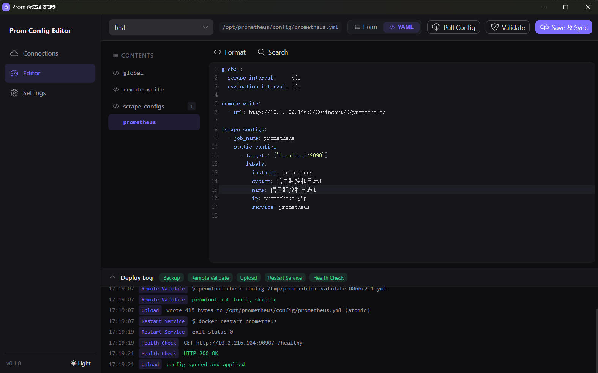

# Prom 配置编辑器

[English](README.md)

跨平台桌面 GUI 工具，通过 SSH 可视化编辑远程服务器上的 Prometheus 配置文件——拉取、表单/YAML 双视图编辑、校验、带自动备份的同步回服务器、重启服务，出问题一键回滚。

后端基于 **Go + Wails v2**，前端基于 **Vue 3 + TypeScript**，支持 Windows / macOS / Linux。

## 界面预览



## 功能特性

- **服务器连接管理** — 支持密码和私钥（含口令）两种 SSH 认证方式；凭据只存操作系统级安全存储（Windows 凭据管理器 / macOS Keychain / Linux Secret Service），保存后不可回读
- **表单 / YAML 双视图编辑** — 结构化表单覆盖 `global` / `rule_files` / `scrape_configs`（任务、目标、标签），YAML 视图基于 CodeMirror 6，支持语法高亮、格式化、搜索；未覆盖的字段原样保留不丢失
- **目录导航** — 两种视图左侧均有目录栏：表单视图滚动定位到区块，YAML 视图精确跳转到各段落/job 所在行；光标移动时目录高亮自动跟随
- **安全同步闭环** — 备份 → 可选远程 `promtool check config` 校验 → 原子上传（`.tmp` + `mv`）→ 执行自定义重启脚本 → HTTP 健康检查，部署日志实时展示每个步骤
- **一键回滚** — 每次同步在服务器保留带时间戳的备份（份数可配），出错随时恢复
- **国际化** — 中英文界面，运行时可切换
- **开发友好** — 前端可独立在浏览器中运行，内置 Mock 后端（`npm run dev`），无需 Go 环境

## 快速开始

前置要求：Go 1.24+、Node.js 22+、[Wails CLI](https://wails.io)（`go install github.com/wailsapp/wails/v2/cmd/wails@latest`）

```bash
# 桌面应用热重载开发（Go + 前端）
wails dev

# 或者：仅浏览器开发前端（使用 Mock 数据）
cd frontend && npm install && npm run dev

# 运行后端测试
go test ./...
```

启动后新建服务器连接，拉取 `prometheus.yml`，编辑并点击「保存并同步」。

## 构建与发布

详见 [docs/BUILD.md](docs/BUILD.md)。简要命令：

```bash
wails build                              # Windows exe / 当前平台二进制
wails build -nsis                        # Windows NSIS 安装包（需安装 NSIS）
wails build -platform darwin/universal   # macOS 通用应用（需在 macOS 上执行）
```

推送 `v*` 标签后由 GitHub Actions 自动构建 Windows + macOS 产物（见 `.github/workflows/release.yml`）。

## 项目结构

```
├── main.go / app.go         # Wails 入口与暴露的 API 方法
├── internal/
│   ├── profile/             # 连接配置本地存储（JSON）
│   ├── secrets/             # 操作系统钥匙串存取
│   ├── sshclient/           # SSH/SFTP 客户端（x/crypto/ssh + pkg/sftp）
│   └── syncer/              # 备份 → 校验 → 上传 → 重启 → 健康检查编排
├── frontend/                # Vue 3 + TS + Pinia + Naive UI + CodeMirror 6
│   └── src/api/             # API 抽象层：Wails 绑定 ⇄ Mock，自动检测
├── docs/
│   ├── DESIGN.md            # 设计文档
│   └── BUILD.md             # 构建与发布指南
└── scripts/generate_icon.py # 应用图标生成脚本
```

## 安全说明

- 密码与密钥口令只存于系统钥匙串，API 返回值中不包含任何敏感数据
- 上传均为原子替换，每次覆盖前强制生成带时间戳的备份
- ⚠️ MVP 阶段暂未启用 SSH 主机密钥校验（`InsecureIgnoreHostKey`），连接生产服务器前请补强（已列入路线图）

## 路线图

- [ ] 基于 `known_hosts` 的 SSH 主机密钥校验
- [ ] 无钥匙串 Linux 桌面的加密文件存储降级方案
- [ ] 基于内存 SSH 服务器（[gliderlabs/ssh](https://github.com/gliderlabs/ssh)）的集成测试
- [ ] Linux 安装包（deb/AppImage）与代码签名

## 许可证

[Apache-2.0](LICENSE)
